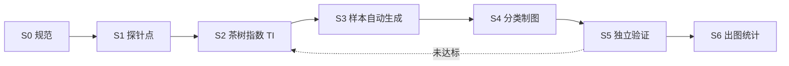

# China Tea 2021 · 中国产茶省份台地茶 10 m 分布制图

基于多源卫星遥感（Sentinel-1/2）与**训练样本自动生成**，制作 2021 年中国产茶省份常规台地茶 10 m 分布图。

方法脉络：杨高翔（2024）冬小麦训练样本自动生成（AGTOC → ATDG → KT-SimSeg）；潘荣玉（2026）江苏茶树 AGRFT。本研究的突破点是构建**不依赖固定物候月份的茶树指数（TI）**，实现跨茶区自适应样本生成。

## 流程（阶段门控：上一阶段验收通过才进入下一阶段）



| 阶段 | 状态 |
|---|---|
| S0 规范 | 进行中 |
| S1–S6 | 未开始 |

## 目录

```
config/      单一配置源（年份、投影、茶区、精度目标）
docs/        研究定义与标注协议、精度目标、茶区与代表区
stages/      每阶段：README（目的/输入/输出/验收）+ 脚本 + check
scripts/     公共工具
ledger/      数据清单与 GEE 资产台账
data/        数据（不入 Git）
```

## 原则

1. 阶段门控，验收不过不往下走。
2. 参数只写在 `config/project.yaml`。
3. 数据不入 Git，来源登记在 `ledger/`。
4. 独立验证点在地图冻结后才抽取，绝不参与调参。
5. 面积一律用等面积投影计算。
